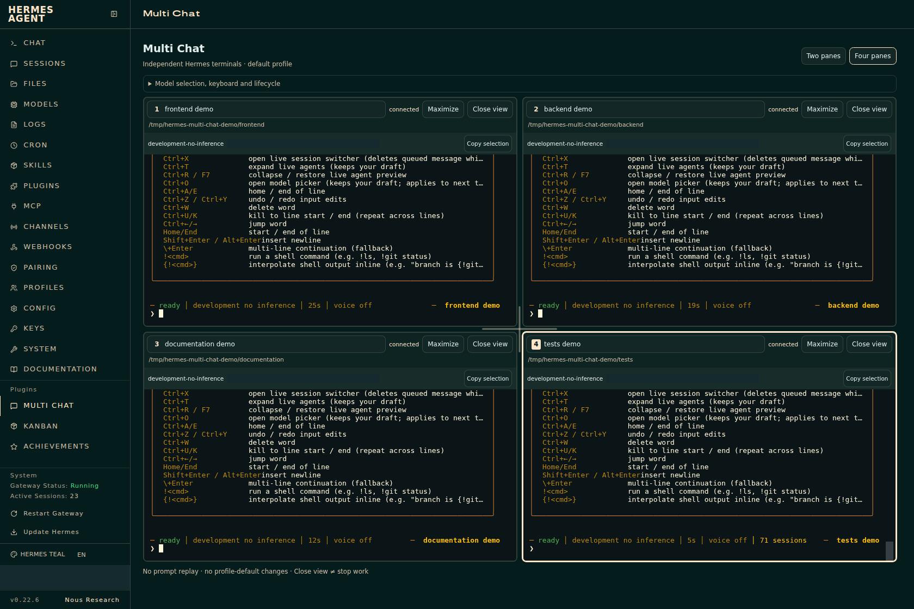

# Multi Chat for Hermes

**Your projects, side by side. One dashboard.**

[](https://github.com/BColsey/hermes-multi-chat/actions/workflows/ci.yml)
[](https://github.com/BColsey/hermes-multi-chat/actions/workflows/security.yml)
[Download v0.1.1 preview](https://github.com/BColsey/hermes-multi-chat/releases/tag/v0.1.1) · [Install](docs/installation.md) · [Docs](docs/index.md) · [Report a bug](https://github.com/BColsey/hermes-multi-chat/issues/new/choose)

Multi Chat adds a **two-pane or four-pane workspace** to the existing **Hermes Web Dashboard**. Each pane runs the real Hermes TUI in its own conversation and project. The normal Chat page stays exactly where it is.



*Disposable demo projects with native TUI help output; no model responses. Account/session identifiers are masked.*

> **Experimental preview.** Supports only Hermes **0.22.6**, commit [`f0d94882e89a`](https://github.com/NousResearch/hermes-agent/commit/f0d94882e89ab8d4098b5bb2f166adfb9ee0a0ab), on a default-profile dashboard with `plugins.isolation: in_process`. Other builds are refused—not silently assumed compatible. Read the [known limits](docs/compatibility.md) before installing.

## Why Multi Chat?

- **Separate projects, separate conversations.** Choose a workspace per pane or resume an existing chat without changing its workspace.
- **The real terminal experience.** Native TUI input, slash commands, tool output and approval UI—not a second chat implementation.
- **A layout that stays out of your way.** Resize, maximize and restore; panes stack on narrow screens. Layout changes do not recreate terminals.
- **Refresh without retyping.** Preserve selections and reuse retained terminals. Prompts are never automatically replayed.
- **HTTP-safe isolation.** Per-pane identities and atomic browser reservations work without Web Locks, including cloned tabs.
- **No core patch.** Uses the Dashboard plugin SDK, locally bundled xterm assets and a small read-only FastAPI adapter. No extra service, second React or runtime CDN.

## Install in a few minutes

Run these commands **on the machine that runs Hermes**, as the same OS user. Python 3.11+ and a compatible, already working Hermes installation are required. No Node.js, pip install, dashboard password or API token is needed to install the prebuilt release.

```bash
curl --fail --location --output install.py \
  https://github.com/BColsey/hermes-multi-chat/releases/download/v0.1.1/install.py

python3 install.py install          # verify compatibility + checksum; preview only
python3 install.py install --apply  # install and enable after you review the plan
```

Then open **Hermes → Plugins → Rescan dashboard extensions**, reload the page, and choose **Multi Chat**. Pick an absolute project directory in each pane and start a conversation. Wait for the TUI's `ready` status **and the pane's session identity** before typing.

The installer verifies the pinned release archive, changes only this plugin's consent, and never restarts a service or changes model/auth/tool settings. Downloading the installer is not the same as executing it: inspect it first if required by your security policy. Checksums detect corruption; they are not independent publisher signatures.

**Custom Hermes paths, offline install or an existing copy?** Use the [installation guide](docs/installation.md). Start with `python3 install.py doctor` if anything is unclear.

## Everyday use

Choose **Two panes** or **Four panes**. Drag the separators—or Tab to them and use arrow keys. **Maximize** expands a pane; **Restore** brings back the previous layout. Alt+Shift+1–4 selects a pane.

Use the native `/model` picker, or `/model provider:model --session`, for a per-conversation model. Avoid `--global` unless you intentionally want a profile-wide change.

**Close view is not stop work.** Use `/stop` in the intended TUI to interrupt its current turn. Detached terminals have a 30-minute retention policy with earlier eviction possible; gateway-owned work can outlive the terminal. Hosted `/exit` is disabled. See [lifecycle and recovery](docs/usage.md#closing-a-view-is-not-stopping-work).

## Manage it safely

Every management command previews first. Updates and removal require an explicit active-work acknowledgement when applied.

```bash
python3 install.py doctor
python3 install.py update
python3 install.py disable --apply --acknowledge-active-work
python3 install.py uninstall --apply --acknowledge-active-work
python3 install.py rollback  # preview the most recent restorable backup
```

Uninstall moves plugin files into a private backup outside plugin discovery. It does **not** delete conversations. [Full update, removal and rollback instructions →](docs/installation.md#update-disable-or-remove)

## Know the boundaries

A rare child-exit race between retention inspection and WebSocket attachment can still create an **idle** replacement. No prompt is replayed. A strict atomic attach-only guarantee needs an upstream/core capability that this plugin does not add.

Model-driven tools, tool approvals/clarifications, long-running model work and real mobile IME/OS clipboard permissions have **not** been verified end to end. [Compatibility and limitations](docs/compatibility.md) distinguish tested behavior from preserved native paths.

Each pane consumes a real TUI process and session context; it is not a lightweight transcript preview. Existing service limits are not increased.

## Build, verify and contribute

```bash
git clone https://github.com/BColsey/hermes-multi-chat.git
cd hermes-multi-chat
npm ci --ignore-scripts
npm run typecheck && npm run lint && npm test
npm run package
```

See [development](docs/development.md) for Python checks, isolated real-dashboard browser tests, release packaging and contribution guidance. [Verification summary](verification/0.1.1.json) · [security scans and SBOMs](docs/security.md) · [third-party notices](docs/third-party.md) · [security policy](.github/SECURITY.md)

### Licensing

[MIT](LICENSE) © 2026 BColsey. Bundled dependencies retain their own licenses.

---

A community plugin for the Hermes Web Dashboard. Not affiliated with or endorsed by Nous Research.
