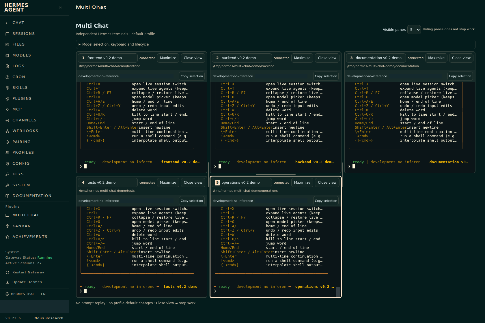

# Multi Chat for Hermes

Independent **1–16 real-TUI conversation panes** inside the existing **Hermes Web Dashboard** at `/multi-chat`. Normal `/chat` is unchanged. Empty slots do not start agents; reducing the visible count hides connected panes without stopping their work.

*Native help output in disposable demo projects, with account/session identifiers masked; no model responses.*

## Compatibility before installation

**Experimental preview.** Only Hermes **0.22.6**, source commit **`f0d94882e89ab8d4098b5bb2f166adfb9ee0a0ab`**, the **default-profile dashboard**, and existing **`plugins.isolation: in_process`** are supported. No Desktop plugin is provided. Linux/POSIX is tested; native Windows is unsupported and macOS/WSL are not verified.

`plugin.yaml` restricts the release to `>=0.22.6,<0.22.7`. The frontend separately checks the exact source commit, default-profile scope and in-process isolation before connecting. The normal Hermes installer can copy the package before those runtime checks; installing the files is not evidence that another build/profile is compatible. Do not change isolation, weaken authentication or upgrade/downgrade Hermes merely to make this plugin run.

## Catalog review status

[Maintainer review](https://github.com/NousResearch/hermes-agent/pull/149251) requires a public read-only dashboard PTY-status seam and feature-based compatibility before listing. This standalone v0.2.2 preview retains the tested exact-build guard and private adapter; those requests are **not addressed**, and catalog acceptance is blocked pending the seam. No support for untested newer Hermes builds is claimed.

## Installation disclosures

Read these before enabling this package:

- **Private core integration:** `dashboard/plugin_api.py` imports `hermes_cli.web_server` and `hermes_cli.web_server_chat`. It reads `app`, `_get_pty_active_session_files(request.app)` and `PTY_REGISTRY._sessions`, and reads the corresponding core-owned active-session marker when its reported size is at most 4 KiB. These are undocumented, version-sensitive internals, not a stable SDK contract. The adapter does not replace core functions or mutate the registry. Maintainers may require a public retention/identity API instead; this package does not add or patch one.
- **API access and trust:** one read-only route, `/api/plugins/multi-chat/pane`, returns retention status, a durable session ID and the retained opaque attachment key. It returns no transcripts or authentication/model secrets. Hermes's existing authentication and plugin-consent gates protect the route. Its Python code runs with the dashboard process's authority, not in a sandbox or separate plugin host.
- **Processes and permissions:** explicitly starting/resuming a pane asks Hermes's existing `/api/pty` endpoint to launch/attach the real TUI. These are real processes and agent sessions with normal Hermes tool permissions and approvals, not transcript previews. The plugin does not execute its own shell commands, provide another agent executor, auto-approve actions or raise resource limits. Native agents can make network/tool calls under the user's existing configuration.
- **Network and credentials:** assets and xterm dependencies are bundled locally. Plugin requests use the authenticated same-origin Hermes SDK; there is no plugin telemetry, runtime CDN, independent provider API, credential-store access or additional service. The plugin does not read `.env`, `auth.json`, browser credential stores or another tool's login; authentication and ticket-bearing WebSocket URLs stay SDK-managed.
- **Directory metadata:** when explicitly browsing projects, the frontend uses Hermes's existing authenticated `/api/fs/list?profile=default` endpoint to list a selected parent folder's immediate directories. Native file-access restrictions and sensitive-path filtering apply. It does not read file contents, recursively scan, write/register projects or execute commands.
- **Stored data:** per-tab sessionStorage holds pane selections, workspaces, the selected projects-directory path and layout. IndexedDB/localStorage hold same-origin ownership reservations and release proofs. These include session/attachment identifiers, not transcripts, prompt drafts or credentials. The browser reservations do not coordinate other browsers/devices, normal Chat or CLI. Core session markers are read outside the plugin's own data directory as described above.
- **Work continues when hidden:** the existing 16-PTY capacity is shared with other dashboard views. Hidden connected panes still count. Closing, disabling or uninstalling this view is not cancellation; use native `/stop` to interrupt a turn. Detached terminal retention/eviction and gateway cleanup remain Hermes's policies.
- **Non-atomic reconnect limit:** a child can exit between the read-only retention check and WebSocket upgrade. Hermes can then create an idle replacement. No prompt/input is replayed; a strict attach-only guarantee needs an upstream capability that this plugin does not supply.
- **Verification limits:** real-Hermes disposable testing exercised all 1–16 empty layouts and five simultaneous TUI conversations. It did not verify sixteen active model sessions, model inference/tools/approvals end to end, sustained load, Firefox/Safari or real mobile IME/clipboard behavior.

## Use and updates

Catalog installation by name is available only after Hermes maintainers accept the listing. This repository/package does not itself imply catalog admission, verification or Nous endorsement.

For an accepted catalog listing, use Hermes's normal plugin installation, consent and update controls. Updates must point to another reviewed catalog SHA; this package contains **no self-updater**. The separate preview-first standalone installer is not included in this distribution.

After installing/enabling in a supported default profile, rescan dashboard extensions, reload and open **Multi Chat**. Select **Visible panes**, choose a project and explicitly start/resume each conversation. Wait for **connected** and the native TUI's **ready** state before typing. New plugin APIs can hot-mount; replacing Python code already imported by a running dashboard requires a separately planned idle-dashboard restart. This package never restarts a service.

The no-op `__init__.py` exists for Hermes 0.22.6's directory-plugin validation; it registers no tools, hooks, middleware, environment requirements, providers or background jobs.

## Source and documentation

The reviewable TypeScript/Python source, dependency lockfile, reproducible build scripts, security automation and aggregate verification records are in the [public source repository](https://github.com/BColsey/hermes-multi-chat). The generated `catalog/dashboard/` payload is byte-compared with the main build by `npm run catalog:check`. No dependency installation is required at plugin runtime; existing Hermes supplies React, FastAPI and PTY execution.

[Compatibility and limits](../docs/compatibility.md) · [Integration contracts](../docs/contracts.md) · [Usage](../docs/usage.md) · [Catalog review procedure](../docs/catalog.md)

[MIT](LICENSE) © 2026 BColsey. Bundled xterm, fit and Unicode11 notices are preserved in `dashboard/dist/licenses/`.

Independent community plugin; not affiliated with or endorsed by Nous Research.
