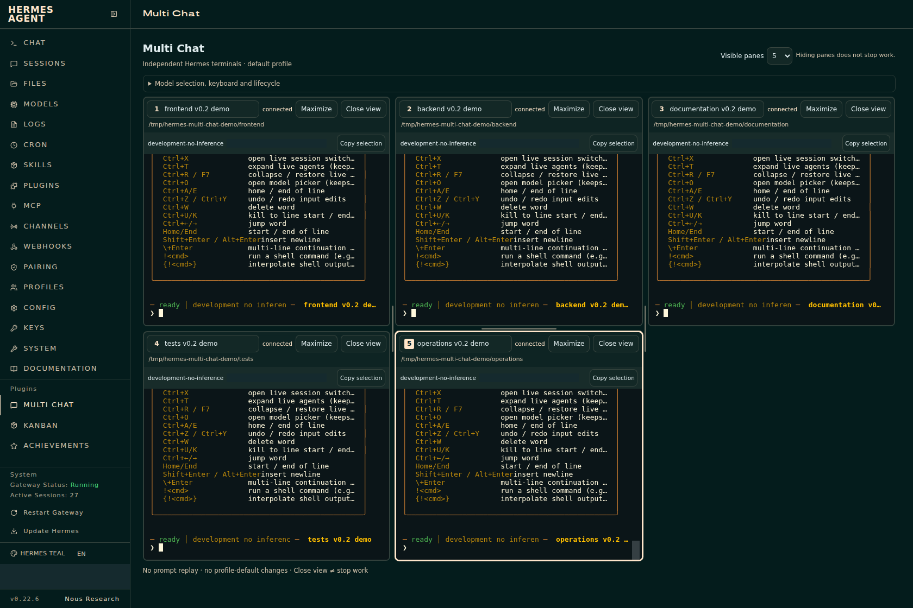
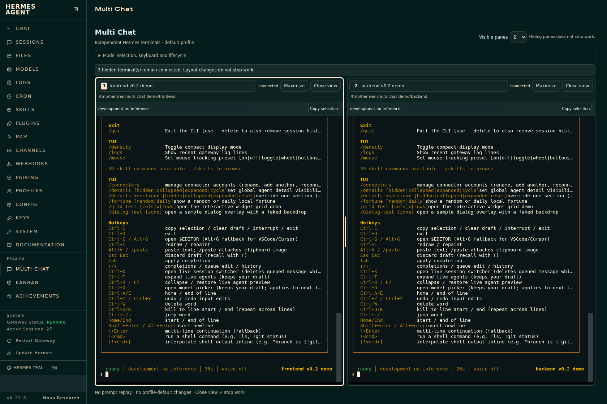
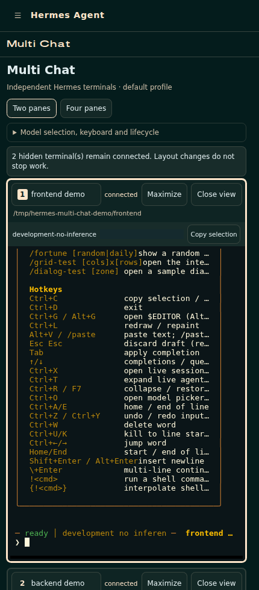

# Use independent chat panes

[Docs](index.md) / Usage

Open **Multi Chat** at `/multi-chat` after [installation](installation.md). Normal Chat remains at `/chat`.

## Start or resume

1. In an empty pane, choose a project from the **Project for a new conversation** dropdown. It lists non-archived Hermes project folders, discovered repositories and the dashboard starting directory, with names and absolute server paths. Choose **Other folder…** to enter a folder not listed. These are existing folders on your **Hermes server**, not new copies or sandboxes. Loading the list never overwrites your choice or manual input. `cwd` is sent explicitly for a new conversation and validated by Hermes.
2. Click **Start new conversation**. Wait for the pane's **connected** badge and the real TUI's **ready** status before typing. “Verifying terminal identity” means input is not ready; a resumed session can already have a prefilled ID/title before its actual attachment is verified. A verified socket is not necessarily a finished TUI bootstrap. If input arrives before verification, the view blocks the whole attempt instead of forwarding a partial draft; wait, click **Retry attachment**, and retype explicitly.
3. For existing work, choose a conversation or enter its exact ID and click **Resume conversation**. Its original workspace is preserved; the new-project selection is not sent on resume.

Recent conversations are limited to 100 in the list; older IDs can still be entered directly. The plugin follows the backend's latest compression descendant. The displayed title, workspace, model and durable session ID come from the current conversation, not another pane's default preference. `/title` requires a unique title in this Hermes build.

Trying to open a selected conversation again focuses its existing pane. Other tabs' browser reservations produce a conflict rather than an automatic takeover. The real TUI can also switch sessions through `/new` and `/resume`; its native confirmation UI remains intact, and a switch into another pane's conversation blocks that view's further input.

Different conversations editing the same checkout are still a repository concurrency problem. Use independent worktrees when appropriate; this plugin does not coordinate code merges.

## Layout and focus

- Choose **Visible panes: 1–16**. This changes layout slots, not the number of agents: a new slot stays empty until you explicitly start/resume a conversation.
- The grid adapts up to four columns, with additional rows and vertical scrolling. Lower counts hide extra panes without disconnecting them; increasing the count reveals their existing views again.
- Drag the vertical/horizontal splitters. Keyboard: Tab to a splitter, arrow keys to resize, Home/End for the supported limits.
- **Maximize** one pane; **Restore** returns the previous sizes and layout.
- The focused pane has a distinct border and numbered badge. Alt+Shift+1–9 selects an existing pane among the first nine, revealing it if hidden. Every pane, including 10–16, is reachable with Tab and its focus button.
- At narrower widths panes stack vertically and the page scrolls. Hidden panes remain connected; the notice states how many. Hiding a pane is not stopping it.

<details>
<summary>See two-pane and narrow-screen examples</summary>







</details>

Existing two/four-pane layouts migrate automatically, preserving all selected/hidden conversations, identities and two-track split sizes. Split proportions are reused when their track count matches; otherwise the new grid starts evenly divided. Maximizing does not alter saved splits.

Layout, selected sessions and attachment identities are stored in this tab's session storage. Transient reconnects and refresh reuse the observed retained PTY. Nothing retypes a prompt. The plugin makes a single creation attempt for an explicit new/resume action; if that attempt's acknowledgement is lost, or the retained terminal is gone, it stops and asks for an explicit selection instead of guessing or spawning replacement work.

A restore older than 29 minutes begins detached. Reattachment is explicit and only succeeds if the backend still retains the terminal. Unsaved terminal drafts, terminal scrollback and prompts are **not** persisted by the plugin.

## Models, input and clipboard

Use the real TUI's `/model` picker, or explicitly type:

```text
/model provider:model --session
```

Replace `provider:model` with an already configured model. Session-scoped selection was browser-tested without a model inference call, including unchanged profile configuration and another pane's unchanged model. The plugin never writes profile model defaults. Avoid `/model --global` and other global-setting slash commands: the TUI is an authenticated operator terminal and retains its normal capabilities.

Slash commands, input editing, streaming, tools and approval/clarification prompts remain the TUI's responsibility. The plugin does not answer approval prompts, change permissions or translate model requests. `/stop` is the deliberate turn interruption command; Ctrl+C may first clear a nonempty draft or act within a dialog.

Paste through the terminal's native browser paste handling. **Copy selection** uses the secure clipboard API only when available and otherwise tries the browser's user-gesture copy fallback. Plain LAN HTTP does not grant clipboard-read permission. Use the browser menu if copying is blocked. Mobile IME and OS clipboard behavior need real-device verification.

## Closing a view is not stopping work

**Close view** asks for confirmation and detaches the view. It does not issue `/stop`, `/new`, `/exit`, a process signal, or delete history. **Reattach retained terminal** returns to that retained view. **Choose another conversation** forgets this pane's selection, without claiming the old work has stopped.

The inspected v0.22.6 lifecycle has two layers:

1. **PTY retention:** `web_server_chat.PTY_REGISTRY` retains an unattached terminal for 30 minutes, with at most 16 PTYs and 1 MiB of replay buffer per PTY. Admission at capacity can evict the oldest detached terminal earlier. Child exit, server shutdown and expiry also close/reap it. This is a terminal lifetime, not a work-duration guarantee.
2. **Gateway-owned execution:** the TUI is a viewer of the canonical gateway. A running/queued turn or delegation can outlive its terminal. The default `sessions.orphan_end_grace_s` is **300 seconds**; after a viewer disappears, orphan closure waits for that grace and for the queue to become idle. It does not turn 30 minutes into a hard work timeout. Startup recovery also considers a six-hour idle threshold. Configuration, queued work, owner shutdown/recovery and tool behavior can change the result.

Hosted dashboard mode **disables `/exit` and `/quit`**. To interrupt work deliberately, type `/stop` in its TUI and inspect the result. Do not use dashboard/gateway restart, plugin removal, or terminal-cap pressure as a cancellation mechanism. There is no promise of indefinite detached execution; use Hermes's proper scheduled/background facilities for work whose lifecycle needs to outlive a view.

## Conflicts and recovery

Ownership uses IndexedDB transactions and explicit document release on `pagehide`, not Web Locks, heartbeat expiry or shared attachment IDs. It works on plain HTTP origins and refuses duplicated sessionStorage identities in a second tab.

A browser crash can leave a reservation. **Recover stale reservation…** is a last-resort action with an interruption warning: close the other view/tab first. Never recover merely because a background tab is slow or suspended. If storage is blocked or the plugin API/build is incompatible, attachment fails closed.

The browser can coordinate its own origin, not a separate browser/device or a normal Chat/CLI client. Explicit resume warns about those clients; Hermes's canonical execution authority remains responsible for the single backend writer. Finish or detach their view before transferring ownership.

## Resource implications

Each started pane means a real Node TUI process and session context, plus configured tool containers and model/quota usage when work is submitted. Empty slots do not spawn agents. The 16-slot UI limit does not reserve or increase the existing shared 16-PTY backend capacity; normal Chat and other views may use some of it. No production CPU/RAM/session limit is increased. The plugin uses the DOM xterm renderer, 3,000 lines of local scrollback per terminal, two authenticated sockets per connected pane, one read-only registry observation per second per pane, and additional observations before human input. Only the focused input path normally incurs those extra checks. Full model/tool memory and throughput were not benchmarked.

Return to the [documentation index](index.md); see [contracts](contracts.md) and [development verification](development.md).
